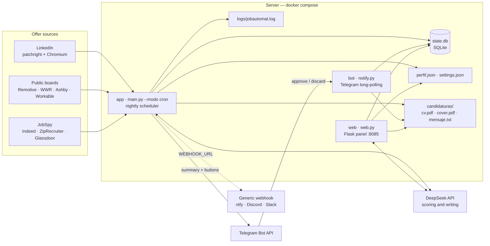

# jobautomat

<!-- Badges -->
[![Python][python-shield]][python-url]
[![Docker][docker-shield]][docker-url]
[![License: MIT][license-shield]][license-url]
[![GHCR][ghcr-shield]][ghcr-url]
[![Ruff][ruff-shield]][ruff-url]
[![Coverage][coverage-shield]][coverage-url]

<!-- PROJECT LOGO / TITLE -->
<br />
<div align="center">
  <p align="center">
    Self-hosted job search assistant: it finds the offers, scores them against your profile, drafts the application material and waits for your approval.
    <br />
    <a href="docs/arquitectura.md"><strong>Explore the architecture docs »</strong></a>
    <br />
    <br />
    <a href="https://github.com/Kauman189/jobautomat/issues">Report Bug</a>
    ·
    <a href="https://github.com/Kauman189/jobautomat/issues">Request Feature</a>
  </p>
</div>

**It never submits an application on its own.** The pipeline prepares everything and leaves it in `./data/candidaturas/<id>/` so that *you* send it.

Designed to run on a small home server or your own laptop with Docker: three containers (scheduler, web panel and bot), one data volume and a saved LinkedIn session. No external services beyond the DeepSeek API and Telegram.

<!-- TABLE OF CONTENTS -->
<details>
  <summary>Table of Contents</summary>
  <ol>
    <li><a href="#about-the-project">About The Project</a></li>
    <li><a href="#features">Features</a></li>
    <li><a href="#architecture">Architecture</a></li>
    <li><a href="#built-with">Built With</a></li>
    <li>
      <a href="#getting-started">Getting Started</a>
      <ul>
        <li><a href="#prerequisites">Prerequisites</a></li>
        <li><a href="#installation">Installation</a></li>
        <li><a href="#full-quickstart">Full quickstart</a></li>
      </ul>
    </li>
    <li>
      <a href="#usage">Usage</a>
      <ul>
        <li><a href="#the-web-panel">The web panel</a></li>
        <li><a href="#telegram">Telegram</a></li>
        <li><a href="#useful-commands">Useful commands</a></li>
      </ul>
    </li>
    <li>
      <a href="#configuration">Configuration</a>
      <ul>
        <li><a href="#main-keys">Main keys</a></li>
        <li><a href="#variables-outside-serviceenv">Variables outside service/.env</a></li>
      </ul>
    </li>
    <li><a href="#exposing-the-panel-over-tls">Exposing the panel over TLS</a></li>
    <li><a href="#local-development-without-docker">Local development (without Docker)</a></li>
    <li><a href="#repository-layout">Repository layout</a></li>
    <li><a href="#troubleshooting">Troubleshooting</a></li>
    <li><a href="#roadmap">Roadmap</a></li>
    <li><a href="#contributing">Contributing</a></li>
    <li><a href="#license">License</a></li>
    <li><a href="#contact">Contact</a></li>
    <li><a href="#legal-notice">Legal notice</a></li>
  </ol>
</details>

<!-- ABOUT THE PROJECT -->
## About The Project

jobautomat automates the tedious half of a job search and stops right before the part that should stay human.

Every night it searches the sources you enabled, filters and scores each offer against your profile with an LLM, and — only for the ones that clear your threshold — drafts a tailored CV, a cover letter and a short recruiter message. You get a Telegram summary with buttons; if you approve, the pack is generated and stored. If you don't, nothing happens.

The whole state lives in one SQLite file plus a few JSON/Markdown files on a Docker volume, so a backup is a `tar` of a directory and moving servers is copying it.

<p align="right">(<a href="#jobautomat">back to top</a>)</p>

<!-- FEATURES -->
## Features

- **Search**: LinkedIn (patchright + headless Chromium), public ATS boards (Workable, BambooHR, Recruitee, Greenhouse, Ashby, Lever, Remotive, We Work Remotely) and Indeed / ZipRecruiter / Glassdoor through JobSpy. If one source fails, the run continues with the rest.
- **Score**: a hard pre-filter (remote, salary, seniority) plus a 0–100 score built from a 5-dimension rubric (fit, growth, compensation, culture, red flags) and an `apply` / `dubious` / `discard` recommendation.
- **Generate**: cover letter, tailored CV as PDF (Harvard-style, two pages) and a short message, built from your `data/perfil.json` and the base CV in Markdown.
- **Approve**: a web panel with pending offers, the score breakdown and downloadable material; approval is also possible from the Telegram buttons.
- **Configure from the panel**: every relevant key is editable in `data/settings.json`, which sits on top of `service/.env`, with type/range validation and secrets always masked.
- **Profile editor**: add data in natural language and let the LLM place it in the right section, or edit the raw JSON when you need to.
- **Self-host diagnostics**: `GET /api/salud` checks the five things that usually break (DeepSeek, Telegram, LinkedIn session, `/data` writability, Chromium) plus a Docker `healthcheck`.
- **Notifications without Telegram**: a generic `WEBHOOK_URL` (ntfy, Discord, Slack…) can replace or complement the bot.
- **Export / import**: move profile and settings between instances as a single JSON file.

<p align="right">(<a href="#jobautomat">back to top</a>)</p>

<!-- ARCHITECTURE -->
## Architecture

```
                 ┌──────────────────────────────────────────────┐
 02:00 (TZ)      │  app: scheduler → main.py --modo cron        │
 ───────────────▶│  search → SQLite dedup → filter → score      │
                 │  → generate material → insert and notify     │
                 └───────────────┬──────────────────────────────┘
                                 │  Telegram (summary + buttons)
                                 ▼
                 ┌──────────────────────────────────────────────┐
                 │  bot: notify.py (long-polling)               │
                 │  Approve / Discard from the phone            │
                 └───────────────┬──────────────────────────────┘
                                 │  same state.db (volume ./data)
                                 ▼
                 ┌──────────────────────────────────────────────┐
                 │  web: Flask on :8085                         │
                 │  Offers · My profile · Ask                   │
                 └──────────────────────────────────────────────┘
```

An opportunity moves through the states `para_confirmar` → `aprobada` / `descartada`. On approval the material is generated (if missing) and stored in `./data/candidaturas/<id>/`, ready for **you** to send. Automatic submission is not implemented.



All three services share the `./data` volume and talk to each other **only through SQLite and the files** — there is no message bus and no internal API. `app` is the only process that calls the sources; `web` and `bot` read and write the same `state.db`. For the block-by-block diagram and responsibilities, see [`docs/arquitectura.md`](docs/arquitectura.md).

`docker-compose.yml` defines three services, all built from the same `Dockerfile` (`python:3.12-slim-bookworm` with patchright and Chromium installed at build time) and sharing the `jobautomat:latest` image:

| Service | Container | Command | Purpose |
| --- | --- | --- | --- |
| `app` | `jobautomat` | `scheduler` (default) | Nightly scheduler; runs the pipeline at the configured time. No published ports. |
| `web` | `jobautomat-web` | `python web.py` | Review panel on `http://localhost:8085` (Flask, HTTP Basic). |
| `bot` | `jobautomat-bot` | `python notify.py` | Telegram bot: sends summaries and listens for approve/discard. |

Volumes:

- `./data:/data` — shared persistent state: `state.db`, `perfil.json`, `settings.json`, `linkedin_session.json`, `logs/` and `candidaturas/`.
- `./service/.env:/run/jobautomat/.env:ro` — secrets, mounted read-only. The entrypoint materialises `/app/service/.env` from it and forces `DB_PATH` / `PERFIL_PATH` onto the `/data` volume.
- `patchright-browsers` (real name `jobautomat-patchright`) — browser cache, seeded from the image on first run.

The container runs as the unprivileged `app` user (**uid 10001**), with `tini` as PID 1 and Chromium already inside the image: nothing is downloaded at runtime.

<p align="right">(<a href="#jobautomat">back to top</a>)</p>

<!-- BUILT WITH -->
## Built With

- [Python 3.12](https://www.python.org/)
- [Flask](https://flask.palletsprojects.com/) — web panel and JSON API
- [SQLite](https://www.sqlite.org/) — the only shared state between services
- [Docker / Compose v2](https://docs.docker.com/compose/) — multi-arch image on GHCR
- [patchright](https://github.com/Kaliiiiiiiiii-Vinyzu/patchright) / [Playwright](https://playwright.dev/) — headless Chromium for LinkedIn
- [JobSpy](https://github.com/speedyapply/JobSpy) — Indeed, ZipRecruiter and Glassdoor
- [DeepSeek API](https://platform.deepseek.com/) — scoring and writing
- [Telegram Bot API](https://core.telegram.org/bots/api) — notifications and approvals

<p align="right">(<a href="#jobautomat">back to top</a>)</p>

<!-- GETTING STARTED -->
## Getting Started

### Prerequisites

- Docker Engine 24+ with the **Compose v2** plugin (`docker compose version`).
- ~2 GB of RAM and 2 GB of free disk (the image ships Chromium).
- A **DeepSeek** API key (<https://platform.deepseek.com>).
- A saved **LinkedIn session** exported to `data/linkedin_session.json` (it expires every few weeks; see below). Optional at first boot, but without it there are no LinkedIn offers.
- Optional: Python 3.10+ on the host, only to export the session or to develop without Docker.
- Optional: a **Telegram bot** and your `chat_id` ([@BotFather](https://t.me/BotFather)) — or set `TELEGRAM_HABILITADO=false` and use a webhook instead.

### Installation

If you just want the published image running, three steps:

```bash
# 1. Configuration: template → secrets (DEEPSEEK_API_KEY, TELEGRAM_BOT_TOKEN)
git clone https://github.com/Kauman189/jobautomat.git && cd jobautomat
cp service/.env.example service/.env
$EDITOR service/.env

# 2. Pull the published image and prepare the volume
docker compose pull                        # ghcr.io/kauman189/jobautomat:latest
sudo chown -R 10001:10001 ./data           # uid of the container's `app` user

# 3. Start the three services
docker compose up -d
docker compose ps
```

Panel at **<http://localhost:8085>** (user `casa`, password `WEB_PASSWORD`; empty = no authentication). `pull_policy: missing` makes `up` build locally if the image is not in the registry; `docker compose pull` only fetches what is published. To pin another tag or use your own build: `JOBAUTOMAT_IMAGE=jobautomat:local docker compose up -d`.

Image: [`ghcr.io/kauman189/jobautomat`](https://github.com/Kauman189/jobautomat/pkgs/container/jobautomat) (multi-arch).

This gives you the skeleton, but **without a profile and a LinkedIn session there are no offers to score**: fill in `data/perfil.json` and `data/linkedin_session.json` following the [full quickstart](#full-quickstart). To run the first pass without waiting until 02:00: `docker compose run --rm app once`.

### Full quickstart

```bash
# 1. Clone the repository
git clone https://github.com/Kauman189/jobautomat.git
cd jobautomat

# 2. Create your configuration from the template
cp service/.env.example service/.env
$EDITOR service/.env        # fill in DEEPSEEK_API_KEY and TELEGRAM_BOT_TOKEN

# 3. Review your profile and base CV (they ship with example/personal data)
$EDITOR data/perfil.json
ls assets/cv/               # base-cv-es.md, base-cv-en.md

# 4. Export the LinkedIn session (on a machine with a browser and a GUI)
python3 -m pip install patchright && patchright install chromium
python3 scripts/export_linkedin_session.py     # writes data/linkedin_session.json

# 5. Volume permissions for the container uid (10001)
sudo chown -R 10001:10001 ./data

# 6. Build and start the three services
docker compose up -d --build

# 7. Check that they are up
docker compose ps
curl -sI http://localhost:8085/ | head -1  # 200 (no password) or 401 (WEB_PASSWORD set)
```

Open the panel at **<http://localhost:8085>**. User: `casa`. Password: the value of `WEB_PASSWORD` (if empty, the panel asks for nothing: use it only on your LAN).

The first search runs at the configured time (`02:00` by default). To run it right now:

```bash
docker compose run --rm app once
```

Material and state live in `./data`, so they survive restarts and `docker compose down` (without `-v`).

<p align="right">(<a href="#jobautomat">back to top</a>)</p>

<!-- USAGE -->
## Usage

### The web panel

- **Offers** — tabs *Pending*, *Approved*, *Discarded* and *All*. Each card shows company, score and recommendation. Opening the detail gives you the description, requirements, "Why this score" (dimensions and red flags) and the **Approve** (generates the pack and makes it downloadable) and **Discard** buttons.
- **Search now** — the panel button runs the same pipeline as the scheduler on demand (`POST /api/buscar`), with live progress read from the service log. No need to wait for 02:00.
- **My profile** — view of `data/perfil.json`: identity, positioning, experience, skills and search criteria. If something does not fit the letters, fix it here; changes apply to the next generation.
- **Ask** — a free-form question to the LLM about an offer or about how to position yourself (company and offer context are optional). Useful for form answers and interview prep.
- **Settings** — the effective configuration, editable, with validation; secrets are always masked.
- **Metrics** — counts by state and by source.
- **Activity** — tail of the service log (`JOB_LOG_PATH`).

Material generated per application in `data/candidaturas/<id>/`: `cv.pdf`, `cover.pdf`, `cover.txt` and `mensaje.txt`.

The approval flow is always the same: offer arrives as `para_confirmar` → you approve from the panel or Telegram → the missing material is generated and stored → state becomes `aprobada`. **Nothing is ever sent to the employer.**

### Telegram

The bot sends one summary per run with inline **Approve** / **Discard** buttons and, in manual mode, one message per offer in real time. Only **one** process may long-poll a given token, so do not run `notify.py` twice against the same bot.

Telegram can be switched off completely (`TELEGRAM_HABILITADO=false`) if you prefer the panel plus a webhook.

### Useful commands

```bash
docker compose ps                     # state of the three services
docker compose logs -f app            # scheduler log
docker compose logs -f bot            # Telegram bot log
docker compose run --rm app once      # force a run now
docker compose exec app python -c "import config; print(sorted(config.load_config()))"
docker compose restart web            # reload the panel
docker compose down                   # stop everything (data stays in ./data)

./scripts/backup.sh                   # copy of ./data into ./backups/jobautomat-<date>.tar.gz
```

To change the schedule without editing the compose file: `CRON_HOUR=7 docker compose up -d`.

#### Backups

All state (offers, profile, LinkedIn session and generated packs) lives in `./data`, so a backup is a `tar` of that directory. `scripts/backup.sh` does it with a timestamp and, when `sqlite3` is available, takes a consistent snapshot of `state.db` with `.backup`:

```bash
./scripts/backup.sh                                     # → ./backups/jobautomat-20261021-023000.tar.gz
sudo DATA_DIR=./data BACKUP_DIR=/mnt/nas/jobautomat ./scripts/backup.sh
```

Restoring means stopping the services, extracting over `./data` (keeping uid `10001`) and starting again:

```bash
docker compose down
tar -xzf backups/jobautomat-20261021-023000.tar.gz -C ./data
sudo chown -R 10001:10001 ./data
docker compose up -d
```

Backups contain session keys and personal data: keep them encrypted and never push them to a repository. `backups/` is not in `.gitignore`; add it if you version state in the same tree.

<p align="right">(<a href="#jobautomat">back to top</a>)</p>

<!-- CONFIGURATION -->
## Configuration

`config.py` reads **`service/.env`** (format `KEY=VALUE`, no quotes needed), not `os.environ`. The full template is `service/.env.example`. On top of that file there is an editable layer at `data/settings.json` (`SETTINGS_PATH`) that **wins** over the `.env`; it is written atomically with `0600` permissions and it is what the panel persists (`GET`/`PUT /api/config`).

### Main keys

| Key | Default | Purpose |
| --- | --- | --- |
| `DEEPSEEK_API_KEY` | — (**required**) | DeepSeek API key. |
| `DEEPSEEK_BASE_URL` | `https://api.deepseek.com/v1` | OpenAI-compatible endpoint. |
| `DEEPSEEK_MODEL` | `deepseek-flash` | Model for scoring, letters and panel answers. |
| `DEEPSEEK_MODEL_PRO` | `deepseek-v4-pro` | Support model for long tasks (tailored CV, forms). |
| `TELEGRAM_BOT_TOKEN` | — | Bot token that sends the summaries (required unless webhook-only mode). |
| `TELEGRAM_CHAT_ID` | — | Your chat with the bot (needed to receive notifications). |
| `TELEGRAM_HABILITADO` | `true` | `false` disables Telegram entirely (panel + webhook only). |
| `WEBHOOK_URL` | empty | Generic webhook (ntfy, Discord, Slack…) that receives the same notice. |
| `WEB_PASSWORD` | empty | Panel password (fixed user `casa`). Empty = no auth. |
| `SCORE_THRESHOLD` | `80` | Minimum score to generate material and notify. |
| `RANGO_DUDOSO_MIN` / `RANGO_DUDOSO_MAX` | `55` / `79` | Score band recommended as "dubious". |
| `IDIOMA_SCORING` | `en` | Language of the descriptive scoring text (`en` or `es`); the `recomendacion` value is never translated. |
| `DB_PATH` | `state.db` | Opportunities SQLite (in Docker: `/data/state.db`). |
| `PERFIL_PATH` | `../data/perfil.json` | Candidate profile (JSON). |
| `SETTINGS_PATH` | `../data/settings.json` | Editable overrides on top of the `.env`. |
| `TOPICS` | `[]` | Extra search topics (JSON list). |
| `ROLES` | `[]` | Target roles (JSON list); they drive the queries. Set your own, e.g. `["Software Engineer"]`. |
| `KEYWORDS_NEGATIVAS` | `[]` | Words that discard an offer (JSON list). |
| `UBICACIONES` | `[]` | Preferred locations (JSON list). |
| `MODALIDAD` | `remoto` | Desired work mode (`remoto`, `hibrido`, `presencial`). |
| `HORA_BUSQUEDA` | `02:00` | Local time of the daily search (`HH:MM`). |
| `DIAS_BUSQUEDA` | `[]` | Active days (JSON list); empty = every day. |
| `FUENTES_LINKEDIN` | `true` | Enable/disable LinkedIn. |
| `FUENTES_BOARDS` | `true` | Enable/disable public boards (Remotive, WWR, Ashby, Workable, BambooHR, Recruitee, Greenhouse, Lever…). |
| `FUENTES_JOBSPY` | `true` | Enable/disable Indeed / ZipRecruiter / Glassdoor. |
| `TEMPERATURA` | `0.4` | LLM temperature (0–2). |
| `SESSION_PATH` | `../data/linkedin_session.json` | patchright `storage_state` for LinkedIn. |
| `LINKEDIN_HEADLESS` | `1` | `1` headless (Docker); `0` opens a window (local). |
| `LINKEDIN_COOLDOWN_SEGUNDOS` | `21600` | Minimum gap between LinkedIn passes (6 h). |
| `MAX_ANTIGUEDAD_DIAS` | `30` | Maximum age of the offers that get scored. |
| `ALERTAR_SESION_LINKEDIN` / `SESION_LINKEDIN_MAX_DIAS` | `true` / `14` | Warn before the LinkedIn session expires. |
| `JOB_LOG_PATH` | `/data/logs/jobautomat.log` | Pipeline log (shown by "Activity"). |

> List-type keys (`TOPICS`, `ROLES`, `UBICACIONES`, `DIAS_BUSQUEDA`, `KEYWORDS_NEGATIVAS`) must be **valid JSON**: `ROLES=["Software Engineer","Data Engineer"]`.

### Variables outside `service/.env`

`docker-compose.yml` interpolates these **from the host environment or from a `.env` file at the project root** (Compose reads it automatically). If you put them only in `service/.env`, the compose `environment:` block overrides them:

| Variable | Default | Effect |
| --- | --- | --- |
| `TZ` | `Europe/Madrid` | Timezone of the scheduler and the panel. |
| `CRON_HOUR` / `CRON_MINUTE` | `2` / `0` | Hour and minute of the daily run. |
| `RUN_ON_START` | `false` | `true` runs one pass when the container starts. |
| `WEB_PASSWORD` | empty | Panel password; define it here so compose does not blank it. |

Example root `.env` (not committed):

```ini
TZ=Europe/Madrid
CRON_HOUR=7
CRON_MINUTE=30
WEB_PASSWORD=a-long-password
```

Inside the container, `DB_PATH`, `PERFIL_PATH`, `SESSION_PATH` and `CANDIDATURAS_DIR` are managed by compose/the entrypoint and point to `/data`; you do not need to touch them.

<p align="right">(<a href="#jobautomat">back to top</a>)</p>

## Exposing the panel over TLS

The panel listens on plain HTTP and authenticates with **Basic auth**. Basic auth sends `user:password` Base64-encoded on every request: over HTTP that is cleartext for anyone on the path. So, if the panel leaves your LAN, **always put it behind HTTPS** — a reverse proxy that terminates TLS (Caddy, Traefik, nginx) and forwards to `127.0.0.1:8085`.

With **Caddy** the Let's Encrypt certificate renews itself. On the server:

```bash
# 1. DNS: the A record of jobs.yourdomain.com must point to the server,
#    and ports 80 and 443 must be open (80 for the ACME challenge).
sudo apt install caddy        # or your distro's package
```

```caddyfile
# /etc/caddy/Caddyfile
jobs.yourdomain.com {
	encode zstd gzip

	# Caddy keeps the original Host, so the panel's CSRF/same-origin
	# check (Origin vs Host) still passes.
	reverse_proxy 127.0.0.1:8085
}
```

```bash
sudo systemctl reload caddy
curl -sI https://jobs.yourdomain.com/ | head -1   # 401: auth active
```

Two settings that go with the proxy:

- **Publish the port on loopback only.** In `docker-compose.yml`, change `"8085:8085"` to `"127.0.0.1:8085:8085"`, so the panel is not reachable directly from the internet, bypassing Caddy.
- **Set `WEB_PASSWORD`** in the root `.env` (not only in `service/.env`: compose blanks it, see [Configuration](#configuration)). Without a password the panel asks for nothing and would be open to anyone reaching it over HTTPS.

Caddy-in-a-container alternative: add a `caddy` service with `ports: ["80:80", "443:443"]`, the `Caddyfile` mounted and a volume for `/data` (certificates); since Caddy and `web` would be on the same Compose network, `reverse_proxy` would point at `web:8085`. If you use another proxy that rewrites `Host`, add the public domain to `ORIGENES_PERMITIDOS` or the panel's POSTs will answer `403`. Behind Cloudflare, set TLS mode to **Full (strict)**.

<p align="right">(<a href="#jobautomat">back to top</a>)</p>

## Local development (without Docker)

```bash
python3 -m venv .venv && source .venv/bin/activate
pip install -r service/requirements.txt
patchright install chromium

cp service/.env.example service/.env    # set LINKEDIN_HEADLESS=0 if you want to see the browser
python service/config.py                # prints only the key NAMES
python service/main.py --modo manual    # pipeline with per-offer output
python service/web.py                   # panel at http://localhost:8085
```

`main.py` accepts `--modo cron` (one summary at the end, the mode Docker uses) or `--modo manual` (one Telegram message per offer in real time). A relative `DB_PATH` resolves against `service/`.

Smoke test with the standard library only (config, SQLite in `/tmp` and one real DeepSeek call; it never prints secrets):

```bash
python3 service/smoke_test.py
```

<p align="right">(<a href="#jobautomat">back to top</a>)</p>

## Repository layout

```
.
├── Dockerfile                 # python:3.12-slim image + patchright/Chromium
├── docker-compose.yml         # app (scheduler) · web (:8085) · bot
├── CHANGELOG.md               # changes per release
├── docker/
│   ├── entrypoint.sh          # materialises .env, seeds browsers, dispatches
│   └── scheduler.sh           # daily loop with log rotation and flock
├── service/
│   ├── main.py                # orchestrator: search → score → generate → notify
│   ├── config.py              # .env + data/settings.json
│   ├── scoring.py             # pre-filter + 5-dimension rubric
│   ├── generate.py            # letter, tailored CV and message
│   ├── pdf_gen.py             # PDF rendering + CV gate
│   ├── health.py              # self-host diagnostics (/api/salud)
│   ├── notify.py              # summary, Telegram bot and generic webhook
│   ├── web.py                 # Flask panel (API + static files)
│   ├── web/                   # index.html, assets and panel i18n
│   ├── search/                # linkedin.py · boards.py · jobspy.py
│   └── requirements.txt
├── assets/cv/                 # base-cv-es.md, base-cv-en.md
├── scripts/
│   ├── backup.sh              # timestamped tar.gz of ./data
│   └── ...                    # LinkedIn session export and utilities
├── data/                      # persistent state (SQLite, profile, logs)
├── backups/                   # output of scripts/backup.sh (do not version)
└── docs/
    ├── arquitectura.md        # diagram and per-block responsibilities
    └── adaptacion-cv.md       # CV tailoring notes
```

<p align="right">(<a href="#jobautomat">back to top</a>)</p>

## Troubleshooting

| Symptom | Cause / fix |
| --- | --- |
| `ERROR: /data is not writable by the app user (uid 10001)` | `sudo chown -R 10001:10001 ./data` and restart. |
| Telegram answers `chat not found` | Open the bot, press **Start** and check `TELEGRAM_CHAT_ID`. |
| The bot ignores the buttons | `docker compose logs -f bot`; only **one** process may long-poll the same token. |
| LinkedIn shows a login page or `ERR_TOO_MANY_REDIRECTS` | Expired session: re-run `python3 scripts/export_linkedin_session.py` and restart `app`. |
| DeepSeek returns `401` / `402` | Invalid key or no balance in `DEEPSEEK_API_KEY`. |
| The panel does not ask for a password | `WEB_PASSWORD` was only in `service/.env` and compose blanks it: define it in the host environment or the root `.env`. |
| No new offers appear | Check `docker compose logs app`: sources may be disabled (`FUENTES_*`) or everything is already in `state.db`. |
| Slow first build | Expected: it installs Chromium and its libraries inside the image (~5 min). |

<p align="right">(<a href="#jobautomat">back to top</a>)</p>

<!-- ROADMAP -->
## Roadmap

- [x] Nightly pipeline: search, dedupe, filter, score, draft and notify
- [x] Telegram approval with inline buttons
- [x] Web panel: offers, profile editor, ask, settings, metrics, export/import
- [x] Multi-arch image on GHCR and a healthcheck
- [x] Generic webhook alternative to Telegram
- [ ] More public board connectors
- [ ] Richer filtering and per-source scheduling

See the [open issues](https://github.com/Kauman189/jobautomat/issues) for a full list of proposed features and known problems.

<p align="right">(<a href="#jobautomat">back to top</a>)</p>

<!-- CONTRIBUTING -->
## Contributing

Contributions are what make open source a nice place to learn, inspire and create. Any contribution you make is **greatly appreciated**.

1. Fork the project
2. Create your feature branch (`git checkout -b feature/AmazingFeature`)
3. Commit your changes (`git commit -m 'Add some AmazingFeature'`)
4. Push to the branch (`git push origin feature/AmazingFeature`)
5. Open a Pull Request

Please keep contributions within the project's scope: it prepares applications and **never submits them**. Before opening a PR that touches the profile or the CV assets, check that no personal data of your own ends up in the diff.

<p align="right">(<a href="#jobautomat">back to top</a>)</p>

<!-- LICENSE -->
## License

Distributed under the MIT License. See [`LICENSE`](LICENSE) for more information.

© 2026 K.189.

<p align="right">(<a href="#jobautomat">back to top</a>)</p>

<!-- CONTACT -->
## Contact

Project link: [https://github.com/Kauman189/jobautomat](https://github.com/Kauman189/jobautomat)

Issues and feature requests: [https://github.com/Kauman189/jobautomat/issues](https://github.com/Kauman189/jobautomat/issues)

<p align="right">(<a href="#jobautomat">back to top</a>)</p>

<!-- LEGAL -->
## Legal notice

- **Use at your own risk.** Automating LinkedIn may violate its Terms of Service and lead to **restrictions or a ban of your account**. Do not use third-party accounts. Start with low volumes and respect rate limits; the project includes waits and a cooldown to reduce the risk, but it **does not remove it**.
- **It does not apply on its own.** This software prepares material and leaves it for review; submitting an application is always a manual action by you.
- **AI-generated content.** Always review letters, CVs and answers before sending them: you may be held responsible for inaccuracies.
- **Personal data.** `data/perfil.json`, `data/linkedin_session.json` and the generated material contain your data. Do not publish them. Before making your fork public, review the profile and CV that ship with the repository.
- The software is distributed **without warranty of any kind**, as stated in the MIT license.

<p align="right">(<a href="#jobautomat">back to top</a>)</p>

<!-- MARKDOWN LINKS & IMAGES -->
[python-shield]: https://img.shields.io/badge/python-3.12-blue?logo=python&logoColor=white
[python-url]: https://www.python.org/
[docker-shield]: https://img.shields.io/badge/docker-compose%20v2-2496ED?logo=docker&logoColor=white
[docker-url]: https://docs.docker.com/compose/
[license-shield]: https://img.shields.io/badge/license-MIT-green
[license-url]: LICENSE
[ghcr-shield]: https://img.shields.io/badge/ghcr.io-kauman189%2Fjobautomat-blue?logo=github
[ghcr-url]: https://github.com/Kauman189/jobautomat/pkgs/container/jobautomat
[ruff-shield]: https://img.shields.io/badge/code%20style-ruff-000000.svg?logo=ruff
[ruff-url]: https://docs.astral.sh/ruff/
[coverage-shield]: https://img.shields.io/badge/coverage-12%25-brightgreen
[coverage-url]: https://coverage.readthedocs.io/
