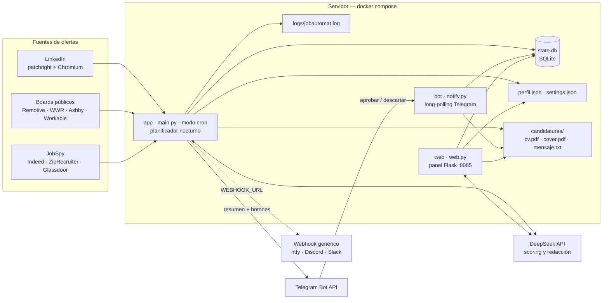

# Arquitectura de jobautomat

jobautomat es un servicio de un solo host: tres contenedores que comparten un
volumen (`./data`) y se comunican **sólo** a través de SQLite y de ficheros. No
hay base de datos servidor, ni cola, ni API interna entre procesos; el estado
compartido es `state.db`.

## Componentes

### `app` — planificador (`service/main.py`)

Es el cerebro y el único proceso que sale a buscar ofertas. `scheduler.sh`
espera a `HORA_BUSQUEDA`, lanza `main.py --modo cron` y repite cada día con
rotación de log y `flock` para que no se solapen dos pasadas. El pipeline es
lineal: buscar en las fuentes activas → deduplicar contra `state.db` → pre-filtro
duro (remoto, salario, antigüedad) → puntuar con el LLM → generar materiales →
insertar y avisar. No publica puertos: sólo necesita salida a internet.

### `bot` — notificaciones y botones (`service/notify.py`)

Hace long-polling de la Bot API de Telegram con `TELEGRAM_BOT_TOKEN` y atiende
los botones **Aprobar / Descartar** de cada aviso, escribiendo el cambio de
estado en el mismo `state.db`. Puede desactivarse con `TELEGRAM_HABILITADO=false`
(sólo webhook y panel) y sólo puede haber **un** proceso escuchando por token.
`notify.py` también contiene `enviar_webhook`, que replica los avisos en
`WEBHOOK_URL` (ntfy, Discord, Slack…).

### `web` — panel de revisión (`service/web.py`)

Flask en el puerto `8085`: lista ofertas por estado, muestra el detalle del
score, permite aprobar/descartar, edita el perfil, responde preguntas con el
LLM y expone configuración, métricas, salud del host e import/export. Sirve los
PDF desde `CANDIDATURAS_DIR`, pero **nunca envía una candidatura**. Se protege
con HTTP Basic (usuario `casa`, `WEB_PASSWORD`), límite de peticiones por IP y
comprobación CSRF/same-origin (`Origin` contra `Host`).

### `state.db` — estado compartido (SQLite)

Una única tabla `oportunidades` con la oferta, la puntuación, la recomendación,
el estado (`para_confirmar` → `aprobada` / `descartada`), las rutas de los
materiales y el resultado del gate del PDF. Es el contrato entre los tres
servicios: `app` inserta, `web` y `bot` leen y cambian estado. Al vivir en
`./data`, sobrevive a reinicios y a `docker compose down`.

### `perfil.json` y `settings.json` — configuración editable

`perfil.json` describe al candidato (identidad, posicionamiento, experiencia,
skills, criterios) y es lo que alimenta el scoring y las cartas.
`settings.json` es la capa que **gana** sobre `service/.env`: se escribe de
forma atómica y con permisos `0600`, y es donde persiste lo que se cambia desde
el panel (`PUT /api/config`).

### `candidaturas/` y `logs/`

`candidaturas/<id>/` guarda el pack generado (`cv.pdf`, `cover.pdf`,
`cover.txt`, `mensaje.txt`) para que lo descargues y lo envíes tú.
`logs/jobautomat.log` es el log del pipeline que muestra la pestaña «Actividad».

### Fuentes: LinkedIn, boards y JobSpy

LinkedIn se consulta con patchright + Chromium headless y la sesión exportada en
`linkedin_session.json` (caduca: hay que renovarla). Los boards públicos
(Remotive, We Work Remotely, Ashby, Workable, Recruitee, BambooHR…) se leen por
HTTP/JSON. JobSpy cubre Indeed, ZipRecruiter y Glassdoor. Cada fuente se puede
apagar por separado (`FUENTES_*`) y un fallo en una no aborta el run.

### DeepSeek API

Endpoint compatible OpenAI (`DEEPSEEK_BASE_URL`) usado para el score 0–100 con
rúbrica de cinco dimensiones, la redacción de carta/CV/mensaje y las respuestas
del panel. Sin `DEEPSEEK_API_KEY` el servicio no arranca: es la única clave
obligatoria.

### Telegram (y webhook genérico)

Telegram transporta el resumen nocturno y los botones de decisión; el webhook es
la alternativa sin Telegram y se limita a empujar texto plano. Ambos son
opcionales para el pipeline: si fallan, la oferta ya está en `state.db` y se
puede revisar en el panel.

## Flujo de una oferta

1. `app` busca a la hora configurada y deduplica por id/URL contra `state.db`.
2. El pre-filtro descarta lo que no encaja; el resto se puntúa con DeepSeek.
3. Por encima de `SCORE_THRESHOLD` se generan materiales y se inserta como
   `para_confirmar`, avisando por Telegram/webhook.
4. Tú apruebas o descartas desde el móvil o el panel; al aprobar se completan
   los materiales que falten en `data/candidaturas/<id>/`.
5. El envío de la candidatura es siempre manual.

## Superficie de despliegue

| Elemento | Valor |
| --- | --- |
| Imagen | `ghcr.io/kauman189/jobautomat:latest` (build local como *fallback*) |
| Servicios | `app` (sin puertos), `web` (`8085`), `bot` (sin puertos) |
| Volumen de estado | `./data:/data` |
| Secretos | `./service/.env` montado en sólo lectura en `/run/jobautomat/.env` |
| Usuario del contenedor | `app`, uid `10001`, `tini` como PID 1 |
| Salud | `GET /healthz` (Docker healthcheck) y `GET /api/salud` (diagnóstico) |
| Copias | `scripts/backup.sh` → `./backups/jobautomat-<fecha>.tar.gz` |

El único puerto que se publica es el del panel: trátalo como interfaz
administrativa y, si sale de la LAN, termínalo siempre detrás de HTTPS (ver
«Exponer con TLS» en el README). Las copias de `./data` contienen la sesión de
LinkedIn y datos personales: cífralas en reposo.
