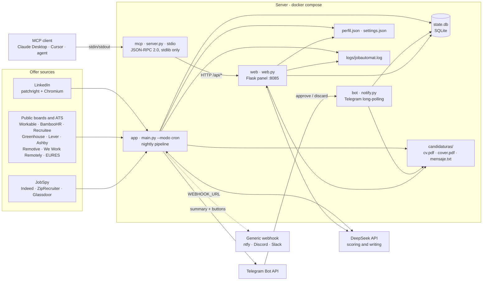

# jobautomat architecture

jobautomat is a single-host service: three containers that share one volume
(`./data`) and talk to each other **only** through SQLite and files. There is no
database server, no queue and no internal API between processes; the shared
state is `state.db`. A fourth component, `mcp/server.py`, is a thin adapter that
exposes the panel API to agents over stdio; it is not a container.



## Components

### `app` — scheduler (`service/main.py`)

It is the brain and the only process that goes out looking for offers.
`scheduler.sh` waits for `HORA_BUSQUEDA`, runs `main.py --modo cron` and repeats
every day with log rotation and `flock`, so two passes never overlap (the panel
"Search now" button shares the same `.buscar.lock`). The pipeline is linear:
search the active sources, deduplicate against `state.db`, apply the hard
pre-filter (remote, salary), score with the LLM in parallel (four threads,
`HILOS_SCORING`) and insert the result. Materials are **not** generated here:
they are produced when the offer is approved. It publishes no ports and only
needs outbound internet access.

**Search is role-agnostic.** The queries come from `ROLES` + `TOPICS` in the
editable config (`data/settings.json`), roles first and then topics as extra
queries. Nothing about a specific role is hardcoded: the module-level `QUERIES`
fallback is empty by default, so the configured roles decide what is searched.
When both lists are empty the pipeline logs a warning telling the user to define
`ROLES` or `TOPICS` in `data/settings.json` (panel → Configuration), skips
LinkedIn, boards and JobSpy and finishes the run with zero offers — it never
assumes a role. What the candidate *is* comes from `data/perfil.json`, which
feeds the scoring, the cover letter and the tailored CV.

### `bot` — notifications and buttons (`service/notify.py`)

It long-polls the Telegram Bot API with `TELEGRAM_BOT_TOKEN` and handles the
**Approve / Discard** buttons of every notice, writing the state change to the
same `state.db`. It can be disabled with `TELEGRAM_HABILITADO=false` (webhook
and panel only) and only **one** process may listen per token. `notify.py` also
holds `enviar_webhook`, which mirrors the notices to `WEBHOOK_URL` (ntfy,
Discord, Slack…).

### `web` — review panel (`service/web.py`)

Flask on port `8085`: lists offers by state, shows the score detail, lets you
approve or discard, edits the profile, answers questions with the LLM and
exposes configuration, metrics, host health and import/export. It serves the
PDFs from `CANDIDATURAS_DIR` but **never submits an application**. It is
protected with HTTP Basic auth (user `casa`, `WEB_PASSWORD`), a per-IP rate
limit and a CSRF/same-origin check (`Origin` against `Host`).

JSON API surface:

| Method | Path | Purpose |
| --- | --- | --- |
| `GET` | `/` | single-page HTML panel |
| `GET` | `/api/ofertas?estado=` | list offers by state |
| `GET` | `/api/oferta/<id>` | detail with the generated materials |
| `POST` | `/api/oferta/<id>/aprobar` | approve and generate the pack |
| `POST` | `/api/oferta/<id>/descartar` | discard |
| `GET` | `/api/perfil` | full profile (`data/perfil.json`) |
| `POST` | `/api/perfil/agregar` | merge a new fact into the profile (LLM) |
| `POST` | `/api/perfil/borrar` | delete a profile key or index |
| `PUT` | `/api/perfil` | replace the whole profile (raw JSON mode) |
| `POST` | `/api/preguntar` | answer application questions with the LLM |
| `GET` | `/api/config` | effective config, secrets masked |
| `PUT` | `/api/config` | update `data/settings.json` (atomic write) |
| `GET` | `/api/metrics` | counts by state and by source |
| `GET` | `/api/salud` | self-host diagnostics (see below) |
| `GET` | `/api/export` | profile + settings export, secrets masked |
| `POST` | `/api/import` | restore profile and/or settings |
| `POST` | `/api/fuente/probar` | probe one board with a real request |
| `GET` | `/api/log?n=` | tail of the pipeline log |
| `GET` | `/api/buscar/estado` | state of the current search run |
| `POST` | `/api/buscar` | launch the pipeline now (202, or 409 if busy) |
| `GET` | `/candidaturas/<path>` | serve `cv.pdf`, `cover.pdf`, `cover.txt` |
| `GET` | `/healthz` | liveness probe (`{"ok": true}`) |

### `mcp` — MCP server over stdio (`mcp/server.py`)

A minimal Model Context Protocol server, **standard library only** (it does not
import the `mcp` SDK). It speaks JSON-RPC 2.0 over stdio: one JSON message per
line on stdin, one JSON response per line on stdout, flushed immediately. It
implements `initialize`, `ping`, `tools/list` and `tools/call`, and every tool
is a thin wrapper around the Flask panel API, so it must run on a machine that
can reach the panel.

Tools: `listar_ofertas`, `detalle_oferta`, `aprobar_oferta`, `descartar_oferta`,
`buscar_ahora`, `leer_config`, `leer_perfil`, `preguntar`, `salud`, `leer_log`.

Configuration is by environment: `JOBAUTOMAT_URL` (default
`http://localhost:8085`), `JOBAUTOMAT_USER` (default `casa`),
`JOBAUTOMAT_PASSWORD` (no auth header when empty) and `JOBAUTOMAT_TIMEOUT`
(default 120 s, because approving an offer runs several LLM calls). It is
registered by the client (Claude Desktop, Cursor, …), not by Compose:

```json
{
  "mcpServers": {
    "jobautomat": {
      "command": "python3",
      "args": ["/abs/path/to/jobautomat/mcp/server.py"],
      "env": {
        "JOBAUTOMAT_URL": "http://localhost:8085",
        "JOBAUTOMAT_PASSWORD": "the-panel-password"
      }
    }
  }
}
```

### `state.db` — shared state (SQLite)

One main table, `oportunidades`, with the offer, the score, the recommendation,
the state (`para_confirmar` → `aprobada` / `descartada`), the paths of the
materials and the PDF gate result. A second table, `score_cache`, keeps the
first score of every offer so a re-run does not re-score (and does not drift)
the same offer. It is the contract between the services: `app` inserts, `web`
and `bot` read and change state. Living in `./data`, it survives restarts and
`docker compose down`.

### `perfil.json` and `settings.json` — editable configuration

`perfil.json` describes the candidate (identity, positioning, experience,
skills, criteria) and feeds both the scoring and the letters. `settings.json` is
the layer that **wins** over `service/.env`: it is written atomically (temp file
+ `os.replace`) with `0600` permissions, and it is where everything changed from
the panel (`PUT /api/config`) persists. Keys outside the `config._CONFIG_DEFS`
spec are ignored with a warning.

### `candidaturas/` and `logs/`

`candidaturas/<id>/` holds the generated pack (`cv.pdf`, `cover.pdf`,
`cover.txt`, `mensaje.txt`) so you can download it and send it yourself.
`logs/jobautomat.log` is the pipeline log shown in the "Activity" tab.

### Sources: LinkedIn, boards and JobSpy

LinkedIn is queried with patchright + headless Chromium and the session exported
to `linkedin_session.json` (it expires: it must be renewed). The public boards
and ATS (Remotive, We Work Remotely, Ashby, Workable, Recruitee, BambooHR,
Greenhouse, Lever, EURES…) are read over HTTP/JSON. JobSpy covers Indeed,
ZipRecruiter and Glassdoor. Each source can be switched off separately
(`FUENTES_LINKEDIN`, `FUENTES_BOARDS`, `FUENTES_JOBSPY`) and a failure in one
never aborts the run: LinkedIn is the main source but no longer essential.

### DeepSeek API

OpenAI-compatible endpoint (`DEEPSEEK_BASE_URL`) used for the 0–100 score with a
five-dimension rubric, the cover letter / CV / message writing and the panel
answers. The rubric is fixed order `encaje`, `crecimiento`, `compensacion`,
`cultura`, `red_flags`, with weights 0.45 / 0.15 / 0.20 / 0.10 / 0.10 used only
as a safety net when the model omits the total. The resulting recommendation is
`aplicar`, `dudoso` or `descartar`, bounded by `RANGO_DUDOSO_MIN` /
`RANGO_DUDOSO_MAX`.

`IDIOMA_SCORING` (`en` by default, or `es`) sets the language of the descriptive
texts the scoring returns; it does not change the score and it is not part of
the `score_cache` key, so switching it does not re-score offers already
evaluated. The recommendation values are never translated.

### Telegram (and the generic webhook)

Telegram carries the nightly summary and the decision buttons; the webhook is
the alternative without Telegram and only pushes plain text. Both are optional
for the pipeline: if they fail, the offer is already in `state.db` and can be
reviewed in the panel.

## Configuration and fail-fast

`service/config.py` is the only loader: `service/.env` (a hand-rolled
`KEY=VALUE` parser, stdlib only) overlaid by `data/settings.json`, which wins.
`_CONFIG_DEFS` declares the type and default of every key, so a typo in
`settings.json` is reported instead of silently absorbed.

Startup is fail-fast on one key only: `DEEPSEEK_API_KEY`. `validar_minimo`
raises when it is missing (nothing can be scored or generated without it), and
`main.py` prints the actionable message and exits with code 1 instead of
starting a run doomed to fail offer after offer. Everything else degrades:
Telegram is optional, and with `TELEGRAM_HABILITADO=false` the service runs on
webhook + panel; if Telegram is enabled but `TELEGRAM_BOT_TOKEN` is empty, a
non-blocking warning is emitted. The panel loads the config with
`estricto=False` so a half-filled configuration can still be displayed.

## Health and diagnostics

Two levels, deliberately separate:

- `GET /healthz` — liveness only (`{"ok": true}`). It is what the Docker
  healthcheck (`curl -fsS http://localhost:8085/healthz`) uses, so it must stay
  instant.
- `GET /api/salud` (backed by `service/health.py`) — real diagnostics, stdlib
  `urllib` only, each block isolated so nothing ever raises: `deepseek` (key
  present and endpoint answering `/models` or a one-token completion),
  `telegram` (`getMe`, skipped when disabled), `linkedin` (session file present
  and its age against `SESION_LINKEDIN_MAX_DIAS`), `data_escribible` (real write
  test in the DB/profile directories) and `chromium` (patchright or playwright
  resolves a binary). The top-level `ok` is true only when every non-skipped
  block is fine. It makes network calls (up to ~5 s per block), which is why
  `/healthz` does not use it.

`python -m service.health` prints the same dict and exits non-zero when degraded.

## Offer flow

1. `app` searches at the configured time, with the queries derived from `ROLES`
   + `TOPICS`, and deduplicates by id/URL/title+company against `state.db`.
2. The pre-filter drops what does not fit (non-remote, salary below the
   profile minimum); the rest is scored with DeepSeek and cached.
3. At or above `SCORE_THRESHOLD` the offer is inserted as `para_confirmar` and
   notified via Telegram/webhook; below it, it is stored as `descartada` so the
   panel can show why.
4. You approve or discard from the phone, the panel or an MCP client; approving
   generates the materials that are missing into `data/candidaturas/<id>/`.
5. Sending the application is always manual: **jobautomat never auto-submits**.
   That is a product constraint, not a pending feature.

## Tooling and CI

- `pyproject.toml` — project metadata (Python 3.12, MIT) and the tool config:
  `ruff` (line-length 100, target py312, rules `E,F,I,W,UP,B`, per-file ignores
  for injected JS/prompt literals) and `coverage` (`branch = true`, source
  `service` and `mcp`, smoke scripts omitted).
- `.pre-commit-config.yaml` — `ruff` (`--fix`), `ruff-format` and the same
  `pytest tests/ -q` that CI runs.
- `.github/workflows/ci.yml` — jobs:
  - `docker`: builds the image exactly as compose uses it and inspects it.
  - `python`: smoke import of every service module on Python 3.12.
  - `lint`: `ruff check .`, `ruff format --check .` and `py_compile` over
    `service/`.
  - `test`: `coverage run -m pytest tests/ -q` plus `coverage report
    --fail-under=11` (`tests/test_config.py`, `test_dedup.py`, `test_health.py`,
    `test_scoring.py`, `test_web.py`).
  - `publish`: multi-arch image (`linux/amd64,linux/arm64`) to GHCR, only on a
    `v*` tag or `workflow_dispatch`, and only after the four jobs above pass.
- Runtime dependencies live in `service/requirements.txt` (installed by the
  Dockerfile); test/lint dependencies in `requirements-dev.txt`.

## Deployment surface

| Element | Value |
| --- | --- |
| Image | `ghcr.io/kauman189/jobautomat:latest` (local build as *fallback*, `JOBAUTOMAT_IMAGE` to pin another) |
| Services | `app` (no ports), `web` (`8085`), `bot` (no ports) |
| State volume | `./data:/data` |
| Secrets | `./service/.env` mounted read-only at `/run/jobautomat/.env` |
| Container user | `app`, uid `10001`, `tini` as PID 1 |
| Health | `GET /healthz` (Docker healthcheck) and `GET /api/salud` (diagnostics) |
| MCP | `mcp/server.py`, stdio, spawned by the client; needs `JOBAUTOMAT_URL` and `JOBAUTOMAT_PASSWORD` |
| Backups | `scripts/backup.sh` → `./backups/jobautomat-<date>.tar.gz` |

The only published port is the panel: treat it as an administrative interface
and, if it leaves the LAN, always terminate it behind HTTPS (see "Exposing with
TLS" in the README). Backups of `./data` contain the LinkedIn session and
personal data: encrypt them at rest.

## License

MIT © K.189. See `LICENSE`.
